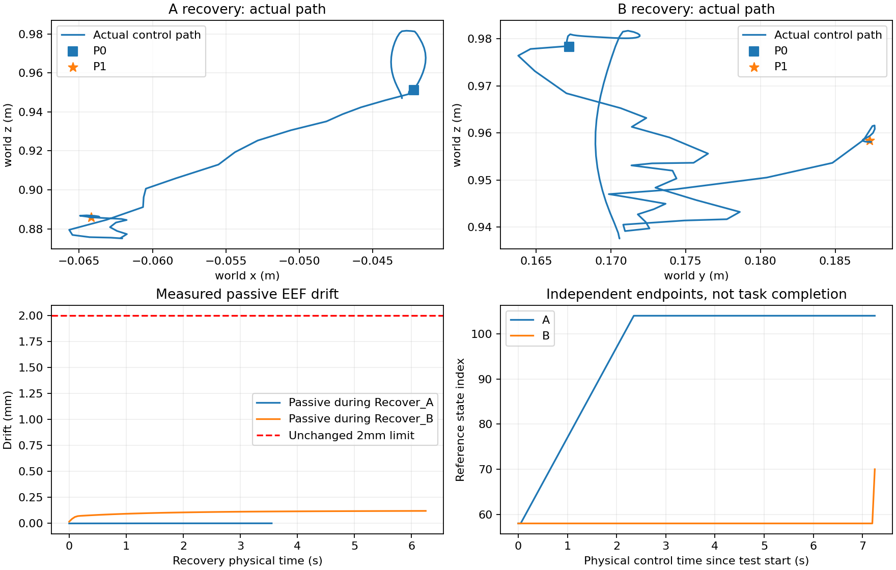

# TwoArmThreePieceAssembly：AutoSERL 滑动窗口与两点恢复报告

本次仅修改当前三件套装配任务的监督器，A=robot0右臂，B=robot1左臂。旧训练已退出，最终 checkpoint 完整保留；未热修改旧训练进程，未从 GitHub main 覆盖服务器。开发分支为 codex/autoserl-two-point。开始时存在183个既有删除项和一处旧部署门禁修改，保持原状，不纳入本次代码提交。

## 论文、实现差异与参数

参考[论文第3.3节](https://arxiv.org/html/2607.01651v1#S3.SS3)及[官方wrapper](https://github.com/autoserl/AutoSERL/blob/main/serl_robot_infra/franka_env/envs/wrappers.py)。本版恢复论文的位置阈值、时间滑窗、全轨迹最近点停滞判断及两点恢复思路；独立窗口、实际抓取/装配屏障、被动臂门禁、物理动作缩放和闭环重放属于本项目的双臂适配。没有复制Franka环境，也没有双臂抓同一物体的假设。

| 项目 | 旧版 | 本版 |
|---|---|---|
| th2位置触发 | 2.5mm | 20mm，位置距离大于阈值 |
| th1位置退出 | 1mm | 5mm；抓取交还另有稳定性门禁 |
| 姿态 | 独立触发干预 | 不触发普通自由空间干预，仅用于可行性及交还检查 |
| 窗口 | 固定向前4索引，贴近才推进 | A长度27，B长度32，无干预真实控制步推进1 |
| 方向 | pipoint附近切向，失败退回锚点 | 全轨迹cpoint切向，夹角≤90°；大于90°或切向为零取消该次滑窗干预，无锚点替代 |
| 停滞 | 20步末端实际位移 | cpoint_t与cpoint_(t-20)的参考位置距离<5mm，且当前cpoint在P0/P1区间 |
| l_term | 5个连续零干预成功Episode | 固定初始状态、严格完整成功且执行干预控制步<10，锁存关闭该worker干预 |
| 被动臂 | 2mm末端、3mm持物漂移等 | 不变；动态进入门禁不变 |

官方代码的窗口包含端点时使用P1-P0+1，并从完整窗口起步；本版依用户要求采用论文的L=P1-P0，初始窗口末端为0，负索引部分裁掉，因此初始只有索引0。停滞缓存21个样本，对应严格20个控制间隔。l_term按官方代码的实际干预控制步计数，另记接管事件次数，避免混淆。成功判据仍是项目原有稳定3步严格协议，没有改奖励来触发关闭。

## 恢复点与数据对齐

原HDF5保存229条动作、229个动作前状态，并非已有230个状态。本次一次合法frame0 reset后，逐条执行全部原始动作，实际采集230个状态，含第229条动作执行后的状态。重放仍能完成严格完整任务。动作a[t]对应s[t]→s[t+1]；P0→P1执行半开区间actions[P0:P1]。230态参考是派生的测量文件，原始HDF5不修改；离线Replay仍严格只读224条有效transition。

| 机械臂 | P0 | P1 | L | 真实接触/抓取 |
|---|---:|---:|---:|---|
| A抓piece_1 | 30 | 57 | 27 | 首次有力接触52，真实抓取53 |
| B抓piece_2 | 38 | 70 | 32 | 首次有力接触64，真实抓取65 |

P0选择在接触及夹爪闭合之前，测得碰撞启用几何最小距离分别22.402mm、21.990mm，实际接触列表为空。上述数值是测量结果，不把论文th2当作物理碰撞安全距离。P1要求连续真实抓取、夹爪完全闭合和物体相对末端平移稳定；运行时交还进一步检查10步相对抓取稳定性及原有物体/姿态边界。

初版候选45/58虽然没有>0.1N力边，几何查询却提示过于接近物体，已弃用，未认作最终安全P0。首次抓取索引53/65也没有被拿来作安全P0。回放与HDF5记录的关节位置存在最高约4.114mm差异，不能声称逐位相同；使用的是本环境真实动作回放参考，并单独核验原始离线transition对齐和严格奖励。

配置为configs/bimanual_autoserl/recovery_points.json，抓取事件为reference_grasps.json，派生参考为reference_trace.npz；保留两臂、物体、原动作及控制时间。完整测量位于outputs/autoserl_two_point/demo_audit.json及proximity.json。

## 控制、边界与保护

每臂独立维护尾随窗口[末端-L+1,末端]及任务事件合法边界。正常真实控制步向前推进，不要求贴近参考；对应臂干预期间窗口冻结，另一臂仅在自身合法阶段内推进。开夹爪不能跨过闭合事件，完全闭合持物不能跨过松开事件；抓取稳定、完成放置等真实事件才开放后续边界。全轨迹cpoint只用于方向与停滞，不用于跳转或回退另一臂进度。pipoint按合法候选中的位置距离选择，并检查抓取关系、物体相对位姿和装配条件。

窗口失配与物理危险已分离。无抓取且通过工作空间/接触检查时，未知independent_carry标签不会结束Episode；不适合接管的候选记录deferred原因并交给策略继续安全探索。真正的超力、机器人碰撞、未验证耦合、意外丢失抓取、被动保持违约等仍停止。新增对实际开夹爪、未抓取、非合法释放情况下推撞任务物体的保护；真实下压测试已触发该保护。80N数值分支通过数值检查，保留每2ms物理监控；没有为证明80N而强行制造高力碰撞。

两点恢复只对空手、目标仍位于已验证拾取位置、无活动接触/耦合、被动臂通过原动态门禁的情况开放。用上升—横移—下降的有界OSC路径回P0，筛查与被动臂/持物的距离；不是把8mm捕获半径简单放大。到P0需更紧的1mm重放对齐条件。随后按原示范时间重放目标臂P0→P1，使用原动作前馈加现有OSC有界误差反馈，保留原夹爪动作；另一臂保持捕获姿态和闭合持物。所有运动经真实MuJoCo控制步，未调用物理状态设置器恢复。

纯动作重放曾造成B物体误差约11.6mm、姿态约0.17rad，无法交还；加入反馈后，在原6mm/0.1rad活动物体门槛内通过。进入ActionScaler完整入口时还发现前馈加反馈可能超出单示范动作域，现将控制输出限制在原物理动作范围，记录饱和维度；原Scaler和归一化统计不改。Replay保存这个最终执行动作，逆缩放误差校验<2e-6，未执行拒绝消息不伪造transition。恢复/重放步全部计为真实交互。

piece_1→base有力接触从105开始，piece_2→piece_1接触在213–215，随后还观测到piece_2与base接触。两段均建立物理事件协调屏障，没有声称验证联合恢复。已完成piece_1后A不得回初始P0；持物长距离返回和未知装配约束下单臂重放均拒绝。原示范在B释放后有一控制步的正常落定过程：只在最近真实支撑、已完成第一件、末段参考位姿及实际开夹爪同时成立时允许最多3步落定，不因此给成功奖励。完整示范回归仍需原严格成功。

## 实测与局限

受控物理测试A/B各3次，名义扰动3/4/5mm，均实际返回P0、重放到P1、稳定抓取、交还并再执行5步策略控制。A恢复期间被动B最大末端漂移约0.00114mm；B恢复期间持物A最大末端漂移约0.121mm，保持2mm/3mm等原边界。另测A恢复时B持物、B恢复时A空手，均通过。准备状态均从原始frame0经实际动作前缀或显式控制到达；准备保持带来的物体/末端变化另存，不能把准备阶段漂移算成已证明的安全恢复。完整控制步数需包含前缀、100/120步准备保持、等待触发、恢复和交还后动作，详见机器统计。

四个相同种子、初始状态及策略动作序列的配对测试：旧版均1步后no_validated_independent_phase；新版49、7、14及至少100步。后者100步由测试主动截断，不能当作自然Episode终点。新版三例因真实被动臂漂移保护停止，一例达到边界，均没有旧错误原因；随机策略中尚未观察到完整两点成功交还或装配推进。不能把Episode变长或loss下降解释成RL已学会任务。

16环境按4+4+4+4初始化，真实NPU策略交互140步，Critic/Actor各140次更新，UTD=1、batch256（128在线+128离线）、3-step不变；强制控制消息验证指定worker独立reset，其余继续。该有界16环境测试每worker仅8–9步，没有发生完整两点接管；两点恢复与记录动作的证据来自上述真实单环境完整入口，不能冒充16环境已跑出恢复成功率。checkpoint载入140在线/224离线后又做了1次真实NPU更新。

风险：抬高路径及门禁是有限场景实测，不是全关节全场景无碰撞证明；原被动门禁仍可能允许随后漂移超界，必须保留实时停止。持物时大幅返回、耦合装配联合恢复尚不支持。受控小样本不能给泛化成功率。正式策略的阶段推进、实际干预交还比例及长期稳定性仍要训练后评价。所有失败尝试均如实保留日志，未降低条件补成功。

正式配置仍使用Ascend910B3集中推理更新，CPU/OSMesa环境，16并行、单示范224离线、10-Q、UTD1、batch256、隔离n-step3；最多50万实际步或10小时。压力测试权重不作为正式预训练。原Actor/Critic/损失/优化器12个文件、严格奖励与成功类AST及n-step实现均核对不变。原始数据SHA与运行证据、吞吐、资源和逐worker统计在同目录机器报告；完整日志、回放、Checkpoint仍在远端outputs与logs独立目录。


## NPU runtime acceptance snapshot

```json
{
  "runtime": {
    "cpu_cores": 22.0,
    "memory_limit_bytes": 208240902144,
    "python": "3.10.20 (main, Jun 11 2026, 15:12:11) [GCC 14.3.0]",
    "packages": {
      "torch": "2.3.1",
      "torch-npu": "2.3.1",
      "torchrl": "0.4.0+b4f4daf",
      "tensordict": "0.4.0+6dc8c68",
      "mujoco": "3.2.3",
      "numpy": "1.23.3"
    },
    "aicore_peak_percent": 75,
    "aicore_all_samples_mean_percent": 6.76595744680851,
    "hbm_peak_mb": 5810
  },
  "counters": {
    "actual_interactions": 140,
    "valid_real_steps": 140,
    "partial_action_attempts": 0,
    "warmup_real_steps": 0,
    "critic_updates": 140,
    "actor_updates": 140,
    "proposals": 144,
    "evaluation_interactions": 0,
    "evaluation_seconds": 0.0
  },
  "actual_steps_s": 2.4823196886036984,
  "updates_s": 2.4823196886036984,
  "utd_effective": 1.0,
  "checkpoint_reload": {
    "passed": true,
    "parameters_exact_on_load": true,
    "optimizer_and_scheduler_loaded": true,
    "online_rows": 140,
    "offline_rows": 224,
    "actual_post_reload_updates": 1,
    "metrics": {
      "data/batch_R": 0.0,
      "train/critic_qt": -0.1978885978460312,
      "train/critic_loss": 0.0017226053168997169,
      "train/encoder_grad_norm": 0.009226691909134388,
      "train/critic_grad_norm": 0.06121032312512398,
      "train/actor_loss_base": 0.09966205805540085,
      "train/actor_loss_total": 0.09966205805540085,
      "train/actor_grad_norm": 0.0011677551083266735
    },
    "physics_resume_boundary": "not tested mid-episode; resume requires new episodes"
  }
}
```


